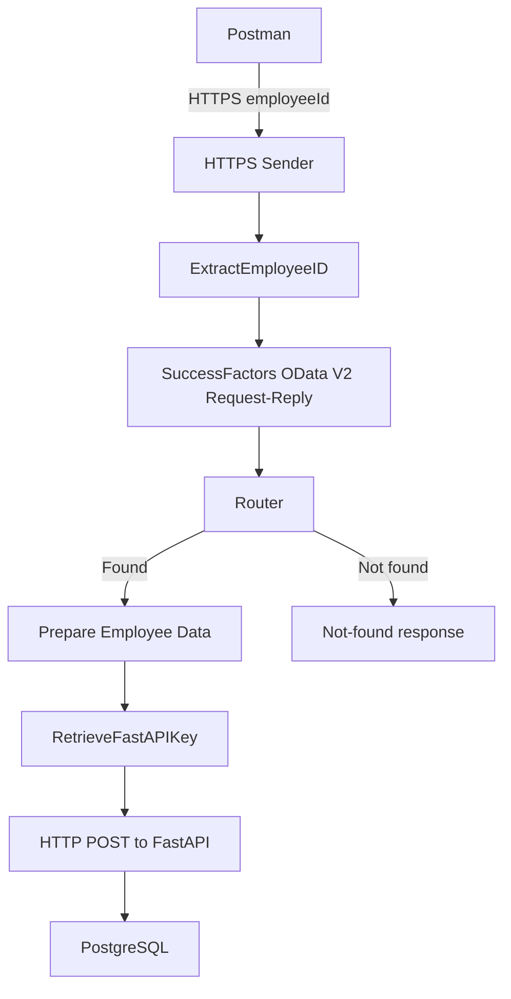

# Solution Architecture

## Overview
SAP Integration Suite acts as middleware between SuccessFactors and a FastAPI application backed by PostgreSQL.

## Component responsibilities
| Component | Responsibility |
|---|---|
| HTTPS Sender | Accepts the inbound request |
| `ExtractEmployeeID` | Extracts the query parameter and makes it available to later steps |
| SuccessFactors receiver | Executes the OData V2 lookup |
| Request-Reply | Waits for the SuccessFactors response |
| Router | Selects found or not-found processing |
| `Prepare Employee Data` | Extracts fields and creates the target JSON body |
| `RetrieveFastAPIKey` | Retrieves the secure parameter and sets the outbound API-key header |
| HTTP receiver | Sends the JSON payload to FastAPI |
| FastAPI | Validates and persists the employee |
| PostgreSQL | Stores the employee record |

## Source query
The query uses the `PerPerson` entity and expands `personalInfoNav` and `employmentNav`. It selects `personIdExternal`, first and last name, user ID, start date and end date. `userId` is obtained through `employmentNav/userId`.

## Transformation
CPI converts the SuccessFactors XML response into a JSON object using target field names. Date values are normalized for the target contract; an absent end date is represented as `null`.

## Security
The FastAPI key is stored in CPI Security Material as a Secure Parameter. The iFlow references the alias and retrieves the secret at runtime; the secret must not be embedded in source code or committed to GitHub. Do not publish traces or screenshots containing authentication headers.

## Error handling
The router sends records with no matching employee to a not-found response path, which does not continue to the FastAPI persistence call. Missing input is handled as a validation scenario. Connectivity, authentication and target API failures require inspection of CPI monitoring and application logs.

## Production considerations
A production design would additionally require enterprise identity controls, least-privilege access, retry and timeout strategy, idempotency, monitoring and alerting, privacy controls, transport governance and operational ownership.
