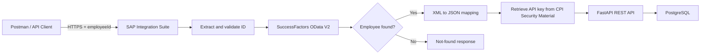

# SAP SuccessFactors Employee Master Data Integration

An end-to-end portfolio integration using **SAP Integration Suite (Cloud Integration/CPI)**, **SAP SuccessFactors OData V2**, **FastAPI**, and **PostgreSQL**.

## Business scenario
A consumer supplies an employee ID to a CPI HTTPS endpoint. CPI retrieves the employee from SuccessFactors, transforms the source XML into a normalized JSON payload, and sends it to FastAPI. FastAPI persists the record in PostgreSQL.

## Architecture


## Technology stack
| Layer | Technology | Responsibility |
|---|---|---|
| API client | Postman | Sends test requests |
| Integration | SAP Integration Suite | Orchestrates retrieval, routing, transformation and delivery |
| Source | SAP SuccessFactors OData V2 | Employee master data |
| Target API | FastAPI | Validates and persists employee data |
| Database | PostgreSQL | Stores employee records |
| Database client | pgAdmin | Verifies persistence |

## Key capabilities
- HTTPS inbound request with a dynamic `employeeId` query parameter.
- SuccessFactors OData V2 lookup using expanded personal and employment navigation properties.
- XML response processing and JSON transformation.
- Employee-found and employee-not-found routing.
- FastAPI API-key authentication using a secure parameter stored in CPI Security Material.
- PostgreSQL persistence.
- Tests for valid, invalid, missing and different employee IDs.

## Data mapping
| SuccessFactors field | Target JSON field |
|---|---|
| `personIdExternal` | `person_id_external` |
| `personalInfoNav/firstName` | `first_name` |
| `personalInfoNav/lastName` | `last_name` |
| `employmentNav/userId` | `user_id` |
| `employmentNav/startDate` | `start_date` |
| `employmentNav/endDate` | `end_date` |

Illustrative payload (fictitious data):
```json
{
  "person_id_external": "EMPLOYEE_1001",
  "first_name": "Alex",
  "last_name": "Morgan",
  "user_id": "EMPLOYEE_1001",
  "start_date": "2025-01-15",
  "end_date": null
}
```

## Repository structure
```text
.
├── CPI_Scripts/
├── Database/
├── Documentation/
├── FastAPI_Application/
├── Screenshots/
└── README.md
```

## Test summary
| Scenario | Expected / observed behavior |
|---|---|
| Valid employee ID | Employee retrieved, sent to FastAPI and verified in PostgreSQL |
| Invalid employee ID | CPI returns the configured not-found response |
| Missing employee ID | Input-validation scenario handled by the flow |
| Dynamic employee ID | Same iFlow processes different supplied IDs |

See [Testing and Results](Documentation/Testing_and_Results.md) for the test summary.

## Security and scope
This repository contains implementation documentation, not tenant exports or credentials. Do not commit API keys, passwords, OAuth secrets, access tokens, live private endpoints, or real employee personal data. Sanitize screenshots before uploading.

This is a learning/portfolio implementation, not a claim of production deployment. Production adoption would require additional controls for identity, monitoring, retries, idempotency, transport governance, privacy and operational support.

## Author
**Aamir Suhail** — SAP Integration Suite | SuccessFactors Integration | API Integration | Automation
